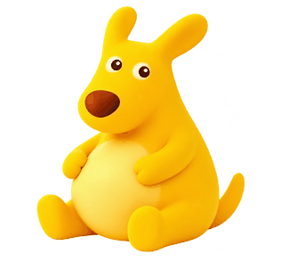
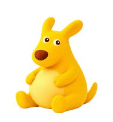

# 肥嘟嘟 · Codex Pet

肥嘟嘟是一只圆肚子、短粗腿的黄色袋鼠。待机坐着眨眼，工作时托腮思考，互动时起身挥手。本项目提供可安装的原生宠物包、透明 PNG/SVG 素材、构建工具和一个可选的 Windows 独立桌面版本。

**当前只保留坐姿待机。旧站姿待机版本、眼罩吐舌比耶造型已从发布包中移除。**



上图是完整六帧源动画；原生客户端按自己的状态行帧数和节奏播放。下面是直接从安装用精灵图导出的挥手预览：



## 下载与选择版本

在 [Releases](https://github.com/Raininnning/codex-pet-feidudu/releases) 下载：

| 文件 | 内容 | 用途 |
| --- | --- | --- |
| `feidudu-native-v1.0.0.zip` | 原生精灵图、描述文件、校验报告、安装脚本和文档 | 直接在 Codex / ChatGPT 桌面应用的 Pets 中选择 |
| `feidudu-source-v1.0.0.zip` | 完整项目源码、PNG/SVG 素材、演示、测试和可选桌面版 | 修改素材、重新构建或开发 |
| `SHA256SUMS.txt` | 两个 ZIP 的 SHA256 | 核对下载文件完整性 |

不需要构建即可安装原生包。安装脚本需要 Node.js 22 或以上；手动复制安装无需 Node.js。

## 原生宠物安装

### Windows 脚本安装

1. 解压原生 ZIP，进入解压后的目录。
2. 安装 Node.js 22 或以上，在该目录打开 PowerShell。
3. 运行：

```powershell
powershell -NoProfile -ExecutionPolicy Bypass -File .\安装肥嘟嘟.ps1
```

4. 在桌面应用中打开 **设置 → Pets → 刷新**，选择 **肥嘟嘟**。
5. 输入 `/pet`，或在命令菜单中选择 **Show pet / 显示宠物**。

安装器先核对精灵图 SHA256 和校验报告，再复制描述文件和 PNG，最后读回检查。重复安装相同内容不会重复写入；覆盖旧版时会将旧文件保存到 `pet-backups`。

### 手动安装

将 `native-pets/feidudu` 中的 `pet.json` 和 `spritesheet.png` 复制到本机 Codex 数据目录的 `pets/feidudu` 文件夹。默认目录：

| 系统 | 默认位置 |
| --- | --- |
| Windows | `%USERPROFILE%\.codex\pets\feidudu\` |
| macOS / Linux | `~/.codex/pets/feidudu/` |

如果设置了 `CODEX_HOME`，使用该目录下面的 `pets/feidudu`。接着刷新 Pets 并选择肥嘟嘟。这里的文件复制不代表所有系统都支持桌面浮动宠物；实际支持范围以桌面应用为准。

更多原生使用方式见 [官方 Pets 文档](https://learn.chatgpt.com/docs/pets)。

## 为什么改了本地图片，窗口仍显示旧比耶造型？

桌面应用可能已经将本地自定义宠物迁移到云端。迁移后，当前选中的是云端宠物，**覆盖本地 PNG 不会自动替换已经上传的精灵图**。

本项目开发时确实遇到过这个情况：本地挥手帧已经更新，云端旧包仍然是眼罩吐舌比耶造型。修复方式是更新同一只云端宠物的精灵图并重新选择它，之后下载云端实际存储的图片与本地包逐像素核对。站姿版本也同时从云端集合移除。

如果你已有迁移过的旧宠物：使用应用提供的宠物更新方式或 Pets 工具更新那一只云端宠物，或者明确安装并选择新的本地包。发布包不包含开发者的云端宠物 ID、账户信息或临时下载链接。刷新后仍显示旧图时，重新打开应用检查；不要将单纯覆盖本地文件当作云端更新成功。

## 动画与尺寸

| 状态 | 素材 | 说明 |
| --- | --- | --- |
| 待机 | 原始睁眼坐姿 + 闭眼帧 | 不提供独立站姿待机选项 |
| 思考 | 托腮有问号 / 无问号 | 保留两帧切换 |
| 互动 | 坐姿、起身、轻跳姿态、举手、挥手、收手 | 完整源动画六帧，约 1.4 秒一轮 |

源 PNG 和 SVG 的画布均为 **1263 × 1246**。互动第一帧来自原始坐姿参考，只做缩放与定位，不重画角色。其余帧按参考修正圆肚子、短粗腿和圆润小手。

为避免切帧时忽大忽小、左右漂移，六帧采用等比缩放，统一可见占画高度为 **1100 像素**，透明度加权视觉重心为 **(631.5, 670)**。不是按每帧透明边框的中心随意摆放，也不通过拉伸宽高改变体型。挥手仍会自然改变轮廓宽度；重心对齐不等于所有像素轮廓完全一致。

原生精灵图固定为 **1536 × 2288**，8 列、11 行，每格 **192 × 208**。有效帧数为：

```text
6, 8, 8, 4, 5, 8, 6, 6, 6, 8, 8
```

共 73 个有效格，另外 15 格完全透明。原生挥手行只有 4 帧、跳跃行只有 5 帧，分别选取六帧源动画的关键帧。互动帧的可见高度约 164 像素，视觉重心与待机帧对齐。

**原生播放节奏由客户端决定。** 本机开发版本的待机周期约 6.6 秒，思考行约 0.82 秒。源动画的 0.8 秒眨眼、1 秒问号切换和 1.4 秒互动参数用于 SVG / 独立桌面版，不能靠宠物包强行改写原生时长。

## 可选 Windows 独立桌面版本

需要完整源码包、Windows PowerShell 和 Node.js 22+。双击 `启动肥嘟嘟.vbs`：

- 透明置顶窗口，拖动即可移动。
- 下方工具栏悬停播放六帧互动；移开后恢复当前待机或思考状态。
- 每 0.8 秒眨眼，其中闭眼 0.2 秒。
- 工作时每 1 秒切换有问号 / 无问号。
- 右键可调整大小、重置工作状态或退出；没有站姿待机选项。

工作状态通过只读扫描本机 `.codex/sessions` 的开始、完成和中断事件联动。它不上传聊天内容，不修改桌面应用的安装文件。日志格式改变、异常退出或远程会话未写入本机日志时，联动可能不准确。

**这是独立窗口，与原生宠物分别运行。** 使用原生版时不要再启动它，否则可能同时出现两只宠物。独立版工具栏不提供原生语音能力。

## 从源码构建

环境：Node.js 22+、Python 3.10+。PNG 校验和预览使用 Pillow；精灵图装配使用 Playwright 的无头 Chromium。

```powershell
npm ci
npx playwright install chromium
python -m pip install -r requirements.txt
npm run build
npm test
npm run test:images
npm run preview
```

`npm run build` 只装配已有帧，不调用图像生成服务。重新生成角色视觉需要图像生成工具；`tools/prepare-hover-animation.cjs` 接受已经生成的三列两行透明动作图，将第一帧替换为原始坐姿，统一缩放与重心后输出六张 PNG 和内嵌 PNG 的 SVG。

`tools/export-previews.py` 从最终精灵图导出各状态 GIF、状态对照表和完整源动画。GIF 演示采用便于观察的播放节奏，不保证与不同客户端版本的实际节奏完全相同。可选 MP4：

```powershell
ffmpeg -y -i docs/previews/native-all-states.gif -pix_fmt yuv420p docs/previews/native-all-states.mp4
```

## 校验与打包

Node 测试覆盖状态优先级、移开恢复、时间切帧、站姿移除、会话事件、安装读回、重复安装和损坏包拒绝。Python 测试读取实际 PNG 像素，检查空白格、帧数、可见尺寸和重心，不仅检查 JSON 参数。

发布包包含结构校验报告 `native-pets/feidudu/validation.json`。报告的 SHA256 必须与实际精灵图一致；任何像素修改后都要重新生成报告，再安装或发布。维护者可使用官方附带的 `validate_atlas.py`。仓库自带的 `tools/validate-spritesheet.py` 检查固定尺寸、73 个必需帧、15 个透明空格、透明角落和隐藏 RGB 残留，并更新实际文件摘要；`npm run build` 会自动运行它。它不替代完整视觉语义质量门，也不能保留旧摘要冒充校验通过。

在测试和校验完成、源码提交后打包：

```powershell
npm run pack
```

脚本在 `dist` 生成原生包、源码包与 SHA256 文件。源码 ZIP 来自已提交的 Git 文件；运行日志、账户状态、缓存、旧包备份和客户端提取文件不进入发布包。

## 目录说明

```text
assets/pets/                 最终透明 PNG、SVG 和源动画配置
native-pets/feidudu/         原生宠物描述、精灵图及结构校验报告
docs/previews/              GIF、MP4、对照图和静态帧
tools/                      装配、对齐、安装、预览和打包工具
tests/                      状态、安装、图片几何回归测试
pet-controller.js           状态与帧选择
session-tracker.js          本地会话事件解析
pet-service.js              可选独立版的本地状态服务
desktop-pet.ps1             可选 Windows 桌面窗口
runtime/                    运行时文件，自动生成且不提交
```

## 已知限制

- 原生悬停、随机动作、拖动吸附、窗口位置与动画速度由客户端处理。宠物包不能保证只在下方工具栏悬停时触发挥手。
- 部分客户端版本切换自定义宠物后，首次拖动可能跳位。本项目做过布局同步排查，但没有在签名安装包内部署客户端补丁；不能声称此问题已经修复。
- 当前重点是坐姿、思考和挥手素材。左右跑动、失败、等待、检查及十六个看向方向的若干格仍复用待机帧，不是完整独立语义动画。
- 为满足视觉中心固定的要求，互动帧采用重心对齐。跳跃行包含起身与轻跳姿态，尚无完整上下运动和落地曲线。
- SVG 内嵌 PNG 以保留平滑材质，它是 SVG 容器，不是纯矢量路径；GitHub 静态页面不一定播放 SVG 动画，因此 README 用 GIF 演示。
- 素材通过结构和对齐验证，不等同于通过完整九状态及十六方向的官方视觉语义质量门。

## 许可证与贡献

实现和文档采用 [MIT](LICENSE)，视觉素材来源见 [ASSETS.md](ASSETS.md)。这是社区项目，不是 OpenAI 官方宠物。

欢迎通过 Issues 报告问题，附上客户端版本、使用原生还是独立版、复现步骤和所用精灵图 SHA256。贡献新动作时请保留原造型、透明背景、画布参数和视觉重心，并运行相关测试。不要提交个人会话日志或临时云端下载链接。
